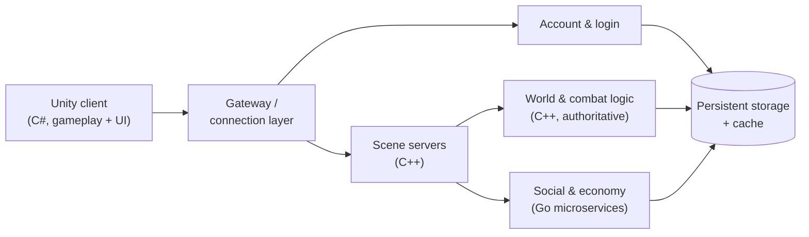

# MMORPG Platform — 0 to 1

**A large-scale multiplayer online RPG built from scratch**
Unity (C#) client · C++ game server · Go microservices

> **Documentation-only repository.** The production code and assets are proprietary and remain
> with the company. This page documents the engineering approach, my role, and the lessons from
> building the product — nothing here is copied from the private codebase.

## At a glance

| | |
| --- | --- |
| **Role** | Technical lead — client architecture, backend architecture, hiring |
| **Period** | 2020 — 2023 |
| **Company** | Shenzhen Yilian Technology |
| **Scope** | 0 → 1: team, architecture, delivery |
| **Stack** | Unity (C#) client · C++ authoritative game server · Go microservices |

## Context

The company set out to build a **large-scale MMORPG** as a new product line, starting from an
empty repository. My job was to turn that goal into a working engineering organisation: define
the technical architecture, hire the front-end and back-end engineers to build it, and keep
delivery on track while the product scope kept growing.

## What I owned

- **Architecture** — designed the client/server split, service boundaries and data ownership
  model; made the first version extensible enough that later features did not require a rewrite.
- **Hiring and team building** — interviewed and onboarded both Unity client engineers and
  C++/Go backend engineers, then trained them into a team that could ship without me in every
  decision loop.
- **Code design and implementation** — stayed hands-on: reviewed designs, wrote core code, and
  removed the technical blockers that stalled features.
- **Delivery process** — defined version planning, review habits and performance expectations so
  multiple parallel workstreams could land predictably.

## Architecture at a high level

A simplified shape of the system — enough to talk about the design, without exposing the
private implementation:

Why this shape:

- **Authoritative server** — the server decides outcomes; the client renders and sends input.
  This keeps combat, loot and progression consistent and makes cheating expensive.
- **Scene-level split** — instances and scenes can be scaled independently instead of forcing one
  process to carry the whole world.
- **Microservices for the non-real-time path** — account, social and economy traffic has very
  different scaling and release cadence from combat ticks, so separating them lets each side
  change without destabilising the other.
- **Extensibility first** — the first version was designed for features that had not been
  specified yet, because an MMO's content volume outgrows any initial plan.

## Lessons worth carrying forward

- **Hire for the architecture you are building, not the one you have.** The client/server split
  only paid off because the first backend hires could own a service end to end.
- **The cost of a late architecture change in an MMO is superlinear** — the earlier the data
  ownership boundaries are fixed, the cheaper every later feature becomes.
- **A tech lead's leverage is in unblocking, not in writing the most code.** The team shipped
  more and better once unclear interfaces were settled in writing.

## Decision records

The architecture decisions behind this case study are written up as ADRs in
[`docs/adr`](docs/adr): the server-authoritative model, the scene/backend service split, and the
C++ / Go language boundary. Each records the context, the decision, the trade-offs and the
alternatives that were rejected.

## Status

The product was developed by the company; this repository is a case study and is not maintained
as software. For the same period see my profile README for the broader career timeline.
